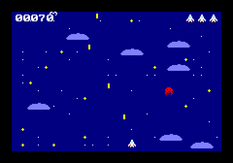
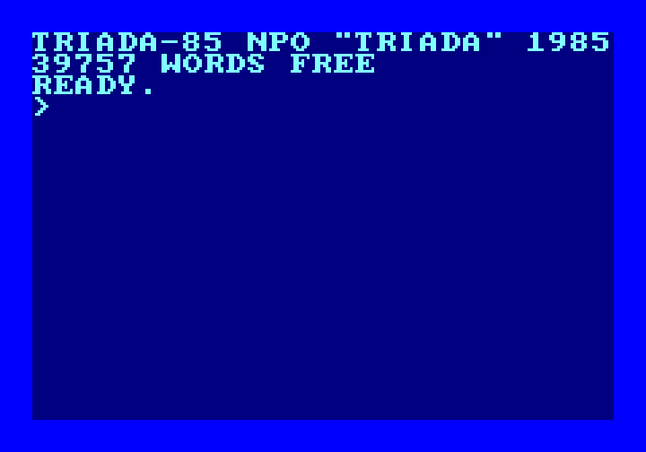
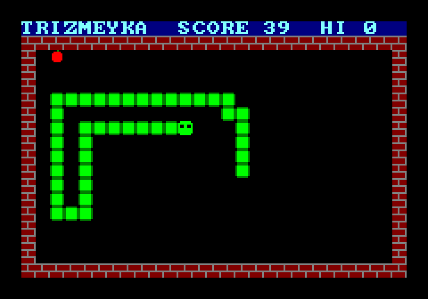
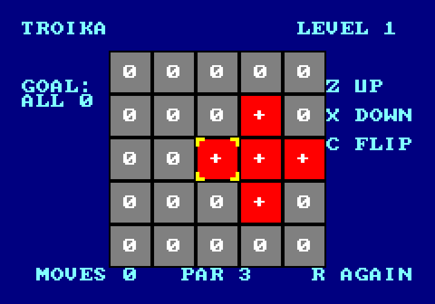
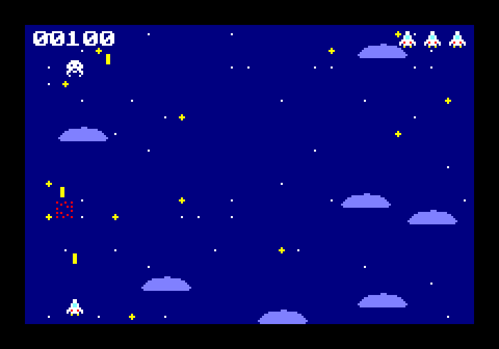
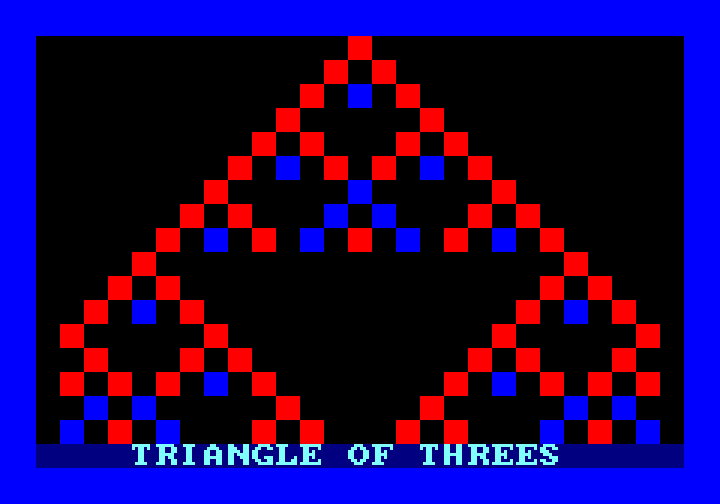
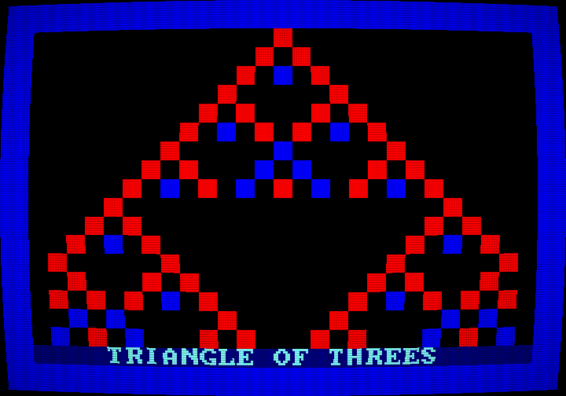

# TRIADA-85

**A home computer that never existed — built in software.**



In our world, computers count in *binary*: every tiny switch inside them is either off or on, 0 or 1. But in 1958 Moscow State University built a computer called **Setun** that counted in *ternary*, with three states instead of two: −1, 0 and +1. It worked well, and then it was forgotten. Binary won.

TRIADA-85 imagines the other timeline. Ternary won in Eastern Europe, and by 1985 a (fictional) factory, NPO "Triada", sells a beige home computer called the TRIADA-85: a membrane keyboard, a three-position joystick, a cassette port and a "triskette" drive. Children type in game listings from the (fictional) magazine *Trit & Tryte*.

**[Switch it on in your browser](https://droidek314.github.io/Triada-85/)**, no installation needed.

This project builds that whole machine as a program you can run on a normal PC or in a web browser: the three-valued arithmetic, the processor, the memory, the screen chip, the sound chip, a small operating system written in the machine's own language, a debugger, three games and the owner's manual. Every step is documented so that someone with no technical background can follow the ideas, and a programmer can rebuild the whole thing from the documents alone.

| Switched on | TRIZMEYKA | TROIKA |
|---|---|---|
|  |  |  |
| **OBLAKA** | **The type-in listing** | **With the CRT look** |
|  |  |  |

## What is in it

- **A machine with trits instead of bits.** Its words are 12 trits (−265,720 … +265,720), its 27 instructions include some no binary computer has (rotate every trit, multiply trit by trit), and its 27 colours are each three trits: red, green, blue. All 531,441 possible words were checked.
- **A processor fast enough.** It runs about 47 million instructions a second on an ordinary PC, 13 times what the real TRIADA-85 would need.
- **Its own assembly language and assembler,** which also turns machine code back into text.
- **A video chip** (tiles, 27 sprites, scrolling) and **a sound chip** (three voices, including the machine's own "ternary square" wave).
- **A ROM written in TRIADA assembly:** boot chime, boot screen, and a monitor with `HELP`, `TERN`, `PEEK`, `POKE`, `RUN`, `CLS`.
- **A debugger** (F1): stop, step, step over, breakpoints, registers in decimal and ternary.
- **Three games**, written in TRIADA assembly: TRIZMEYKA (a snake whose food comes in three trit colours), TROIKA (a puzzle whose moves are the CPU's own trit-wise instructions) and OBLAKA (a scrolling shooter).
- **The [owner's manual](docs/manual/README.md),** written as if printed in 1985, with a type-in listing from *Trit & Tryte*. Its examples are checked by tests against the real machine.
- **An optional CRT look** (F2): curved glass, scanlines, phosphor stripes.
- **[A web version](https://droidek314.github.io/Triada-85/)**: the same machine in a browser, with everything except the debugger, published by GitHub after every change that passes the tests.
- **540 automatic tests**, from single trits to tests that play the games and type in the manual's listing.

## How to run

The quickest way: open **https://droidek314.github.io/Triada-85/** and type, or pick a program. The download below adds the debugger and the command-line tools.

You need a Java Development Kit (**JDK**) version 25. Gradle, the build tool, downloads itself. On Windows, use `gradlew.bat` instead of `./gradlew` if you are not in a Bash-style shell.

Build everything and run all tests:

```bash
./gradlew build
```

Switch the machine on. It plays its chime and waits at `READY.` (try `HELP`, `TERN 42`, `PEEK 243 3`):

```bash
./gradlew :triada-desktop:run
```

Play the games: arrow keys to move, Z to start (TROIKA also uses X, C and R):

```bash
./gradlew :triada-desktop:run --args="--load programs/trizmeyka.tasm"
```

```bash
./gradlew :triada-desktop:run --args="--load programs/troika.tasm"
```

```bash
./gradlew :triada-desktop:run --args="--load programs/oblaka.tasm --crt"
```

In the window:

| Key | |
|---|---|
| arrow keys | the joystick |
| Z, X, C | fire buttons A, B, C |
| F1 | the debugger: F5 pause/continue, F11 step, F10 step over, click a line for a breakpoint |
| F2 | the CRT look on/off |
| drop a file on the window | "insert a triskette": the machine restarts and runs it |

More programs are in [`programs/`](programs/), for example `colors.tasm` (all 27 colours), `piano.tasm` (your keyboard as a piano) and `triangle.tasm` (the type-in listing).

Without a window, the command-line tool `triada` assembles (`tasm`) and runs (`run`) programs, and can save the screen and the sound:

```bash
./gradlew :triada-cli:run --args="run programs/hello.tasm"
```

```bash
./gradlew :triada-cli:run --args="run programs/troika.tasm --frames 80 --dump-screen build/troika.png"
```

Or install it once (its launcher needs `JAVA_HOME` pointing to a JDK 25), then `triada help` lists every command:

```bash
./gradlew :triada-cli:installDist
```

```bash
triada-cli/build/install/triada/bin/triada help
```

Build the web version yourself and serve it at http://localhost:8385/:

```bash
./gradlew :triada-web:gdx_teavm_web_js_run
```

The desktop can also save a picture without opening a visible window, for example with the CRT look:

```bash
./gradlew :triada-desktop:run --args="--load programs/triangle.tasm --crt --frames 140 --capture build/crt.png"
```

## Where to start reading

- **[docs/INDEX.md](docs/INDEX.md)**: the reading guide to every document, in order. The milestone documents read like a book: *How to build a computer that never existed.*
- **[docs/manual/](docs/manual/README.md)**: the owner's manual, if you just want to use the machine.
- **[docs/SPEC.md](docs/SPEC.md)**: the exact technical description of the machine.
- **[docs/RETROSPECTIVE.md](docs/RETROSPECTIVE.md)**: what went well, what was hard, what we would do differently.

## How the project is laid out

| Folder | What |
|---|---|
| `triada-core/` | The machine: ternary math, memory, CPU, video, sound, input. Plain Java, no graphics library. |
| `triada-assembler/` | The assembler and disassembler. |
| `triada-rom/` | Builds the ROM from `rom/` into the emulator. |
| `triada-cli/` | The `triada` command-line tool, and the tests that run whole programs. |
| `triada-app/` | What the desktop and the web version share: the picture, the CRT look, the keyboard (libGDX). |
| `triada-desktop/` | The window, sound, debugger and command line of the download (libGDX). |
| `triada-web/` | The browser version and its page (libGDX web backend gdx-teavm). |
| `rom/` | The ROM's source, in TRIADA assembly. |
| `programs/` | Example programs and the three games, in TRIADA assembly. |
| `docs/` | Everything written about it. |

Status: all milestones, **M0 to M11**, are done, and so is the web version (**M12**, a stretch goal). See [docs/PROGRESS.md](docs/PROGRESS.md).
