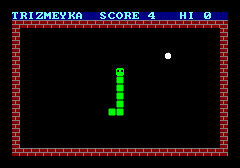
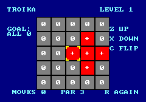
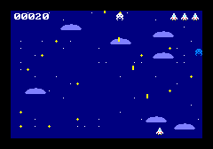

# Milestone 10 — Games

## In one paragraph
A computer from 1985 was judged by its games. This milestone gives the TRIADA-85 three of them, all written in the machine's own assembly language, the way people typed them in from magazines back then. **TRIZMEYKA** is a snake game whose food comes in the three trit colours. **TROIKA** is a puzzle that only a ternary machine could have invented: a board of −1, 0 and +1 cells that you rotate and flip back to all zeros. **OBLAKA** is a shooter flying through a night sky full of clouds, with a scrolling background and up to two dozen moving sprites. Each game was tested the way a player would play it, by pressing buttons and reading the screen, and two of them were also played by small "autopilot" programs for two minutes of game time.

## What was built
- **`programs/lib/game.tasm`**: a small library the games include. It copies memory, fills tiles and the tile map, picks random numbers, prints at a position, and paints tiles from black-and-white masks, even turning the ROM font back into masks ([D-033](../DECISIONS.md#d-033--the-games-share-an-include-library-the-same-controls-and-the-same-register-habits---milestone-m10-2026-11-08)).
- **TRIZMEYKA** (`programs/trizmeyka.tasm`, 685 words): the snake game. It has walls, food worth 1, 2 or 3 points (blue −1, white 0, red +1), growing, a score and hi-score, sounds, GAME OVER and restart.
- **TROIKA** (`programs/troika.tasm`, 1004 words): the ternary puzzle of our own design ([D-034](../DECISIONS.md#d-034--troika-a-ternary-lights-out-whose-moves-are-trit-wise-instructions---milestone-m10-2026-11-08)). It has a 5 × 5 board, three kinds of move, levels with a par, restart with R, and a chord when you solve one.
- **OBLAKA** (`programs/oblaka.tasm`, 1321 words): the vertical shooter. It has a scrolling starry sky with clouds, a ship, 4 shots, 12 enemies of three trit kinds with a "ternary wobble", explosions, a score and lives drawn with sprites ([D-035](../DECISIONS.md#d-035--oblaka-a-fixed-status-line-made-of-sprites-and-tiles-painted-from-masks---milestone-m10-2026-11-08)), three ships, GAME OVER, a hi-score and sounds.
- **34 new tests** in `triada-cli`: 12 for TRIZMEYKA, 9 for TROIKA and 13 for OBLAKA. Each game has a smoke test (does it start and keep running without a fault?), gameplay tests, and a golden screenshot (a stored picture the screen must match pixel for pixel). There is also a shared test helper, `GameHarness`.
- **A build fix:** Gradle now knows that the CLI tests read `programs/`, so changing a game re-runs them (see "Problems").

The three games, as the tests' golden screenshots show them (240 × 168 pixels each, border included):

| TRIZMEYKA | TROIKA | OBLAKA |
|---|---|---|
|  |  |  |

## Why it was built this way

**Ternary in the rules, not only in the paint.** Each game uses trits where they change how it plays. In TRIZMEYKA the food's trit sets its value. In OBLAKA the enemy's trit sets its points and speed, and a random trit steers it. TROIKA is built entirely from trits: the cells, the moves and even the way the program computes a move.

**Each game shows off one part of the machine.** TRIZMEYKA uses the tile map as its playing field, so "what is in front of the snake?" is one memory read. TROIKA uses the trit-wise instructions (ROT, TMUL), which no binary machine has. OBLAKA uses scrolling and sprites to the full: 25 of the 27 sprites can be on screen at once.

**One small library, one set of controls.** The three games share helper routines through `.include`, and they all start with Z and move with the arrow keys ([D-033](../DECISIONS.md#d-033--the-games-share-an-include-library-the-same-controls-and-the-same-register-habits---milestone-m10-2026-11-08)). Nothing new went into the ROM or the SPEC: the games only use what the machine already offers.

**Tiles painted by arithmetic.** Instead of drawing every tile in every colour, the games store black-and-white masks and colour them when they start ([D-035](../DECISIONS.md#d-035--oblaka-a-fixed-status-line-made-of-sprites-and-tiles-painted-from-masks---milestone-m10-2026-11-08)). It saves typing and memory, and it works because of how the TRIADA packs pixels (explained below).

**Tests that play.** A game is hard to test by looking at its code. So the tests press the joystick and the buttons frame by frame, then read the tile map, the sprite table and the game's variables, just like the debugger would. For TROIKA, a separate Java model of the rules checks every move. For the snake and the shooter, an autopilot plays for two minutes, which reaches corners of the game no hand-written test would (a 100-segment snake, 24 sprites at once).

## How it works — the plain-language version

### TRIZMEYKA: a snake in a ring
The screen is a grid of 27 × 18 *tiles* (small 8 × 8-pixel pictures; the grid is the *tile map*). The snake game uses the grid itself as the playing field: each cell holds floor, wall, snake or food. To find out what the snake is about to bite, the program looks at one cell.

The snake moves one cell every 6 frames (10 times a second). Moving a snake doesn't mean moving every segment. You only need to:
1. draw a new head in front,
2. turn the old head into body,
3. erase the last tail segment, unless the snake is still growing.

To know where the tail is, the program keeps a list of the cells the snake occupies, in order. The list is a **ring buffer**: think of a round table with 480 numbered seats. The head sits down at the next seat each step and the tail gets up from the oldest one. When the head reaches seat 479, it continues at seat 0. The list never has to be moved, only the two seat numbers change.

Food is a random trit: blue −1, white 0 or red +1. Eating it gives *trit + 2* points (1, 2 or 3) and as many new segments, with a beep that is higher for better food. Hitting a wall or yourself ends the game with a noisy crash. Your best score stays as the HI score until the machine is switched off.

### TROIKA: a puzzle made of trits
The board has 5 × 5 cells, each a trit: blue "−", grey "0" or red "+". The goal is to make every cell 0. You move a yellow cursor, and each move changes the cell under it **and its four neighbours** (a "+"-shaped cross):

```
 Z: rotate up      -  ->  0  ->  +  ->  -       (like a three-hour clock)
 X: rotate down    +  ->  0  ->  -  ->  +
 C: flip           -  <->  +      0 stays 0
```

Every level starts from a solved board, and the program makes some random moves to scramble it (3 on level 1, 4 on level 2 …). So every level can be solved, and the number of scrambling moves is shown as **PAR**: you know a solution that short exists. Press R to start the level again.

Why is it hard? Rotations alone could be undone in any order, like adding and subtracting. The flip spoils that. Take a 0 cell: "up, then flip" gives −1, but "flip, then up" gives +1. So **the order of your moves matters**.

**The ternary trick.** The program doesn't change the five cells one by one. Each board row is *one machine word*, with one trit per cell, and the CPU has instructions that work on all the trits of a word at once:
- `ROT` turns every trit of a word up (or down) in one go;
- `TMUL` multiplies two words trit by trit (+1 keeps a trit, 0 erases it, −1 flips it).

A **mask** word says which cells the move touches: +1 where it acts, 0 elsewhere. A worked example, with the cursor in the middle column of this row:

```
 cells (column 0..4)          -   0   +   0   +      word = -81 + 0 + 9 + 0 + 1 = -71
 mask (columns 1, 2, 3)       0   +   +   +   0      27 + 9 + 3 = 39
 ROT up of the whole row      0   +   -   +   -      (every trit up)
 TMUL with the mask           0   +   -   +   0      keep only the cross's cells
 TMUL row with (121 - 39)     -   0   0   0   +      keep only the other cells (121 = +++++)
 add the two                  -   +   -   +   +      = -81 + 27 - 9 + 3 + 1 = -59
```

The two halves never have a non-zero trit in the same place, so adding them never carries. The flip is a single multiplication by 121 − 39 − 39 = 43, which is `+ − − − +`: +1 keeps the outer cells and −1 flips the three in the cross.

### OBLAKA: flying over the clouds
The night sky is the tile map, with random stars and clouds. Each frame the program lowers the SCROLL_Y register by one. The video chip then shows the map one pixel further down, so the sky seems to flow past while the ship flies up. The map wraps around (the bottom continues at the top), so the flight never ends.

Anything that must *not* scroll is a **sprite** (a small picture the video chip draws at any position, on top of the background): the ship, its shots, the enemies, and also the score and the ships left. The program uses the video chip's sprite table as its list of objects. A sprite that is switched off (FLAGS = 0) is a free slot for a new shot or enemy.

Enemies come in three trit kinds: azure −1 (10 points), white 0 (20) and red +1 (30, and twice as fast). Every 16 frames each enemy picks a new random trit as its sideways speed, so the formation wobbles −1, 0 or +1 pixel per frame. A shot that comes within 6 pixels of an enemy (in both directions) destroys it. An enemy that touches the ship costs one of three ships. After a hit the ship blinks for two seconds and can't be hit again.

### Painting tiles with arithmetic
A tile row is 2 words of 4 pixels, and a word is just a sum:
*word = p0 · 19683 + p1 · 729 + p2 · 27 + p3*.
Store a drawing as a **mask** (pixels only 0 or 1) and you can colour it with one multiplication and one addition. Every 1 becomes the foreground colour and every 0 the background:

```
 word = bg · 20440 + (fg − bg) · mask          (20440 = 19683 + 729 + 27 + 1)

 example: a red cell's left edge, mask row 1 0 0 0, edge black (-13), cell red (5)
   5 · 20440 + (-13 - 5) · (1 · 19683) = 102200 - 354294 = -252094
   check: pixels -13 5 5 5 -> -13·19683 + 5·729 + 5·27 + 5 = -252094
```

With background 0 the result is a sprite tile with a transparent background. The ROM font is drawn the same way (light cyan 4 on dark blue −12), so the games can also turn a font character *back* into a mask, then paint it in any colour. That is how TROIKA gets its white −, 0 and +, and OBLAKA its score digits.

## How it works — the programmer's version

Read in this order: the library, then TRIZMEYKA (the simplest), TROIKA, OBLAKA, then the tests.

### 1. The library — [`programs/lib/game.tasm`](../../programs/lib/game.tasm)
- `copywords`, `solidtile`, `fillmap`: loops of `ST` and `INC`.
- `random`: `RAND MOD n` and a fix for TRIADA's rounding MOD. The result lies between −n/2 and n/2, so a negative result gets n added, giving 0 … n − 1.
- `printat` and `numat`: `LOCATE`, then a **tail call** (`JMP PRINT`, so PRINT's `RET` goes straight back to our caller).
- `maskpaint`: the colouring formula above. Callers set the colours in `paint_bg` and `paint_fg` first.
- `glyphmask`: a font word is −12 · 20440 + 16 · mask, so *mask = word DIV 16 + 15330*. Both divisions are exact, so TRIADA's rounding doesn't matter here.

All of them keep R3–R8, like the ROM's routines. The file is included at the *end* of each game, after the game's own code: `.include` inserts code where it stands, and the game's first instruction must stay at address 243.

### 2. TRIZMEYKA — [`programs/trizmeyka.tasm`](../../programs/trizmeyka.tasm)
- Register habits: `R6` = IO_BASE and `R7` = `vars` for the whole program. A variable is `[R7+V_SCORE]`, an I/O register `[R6+JOY_X]`.
- `frame` → `steer` every frame, `move` every `STEP` frames. `waiting` starts a game on a *new* press of Z: it compares BTN_A with its value in the previous frame (`V_PREVA`), so holding the button starts only one game.
- `steer` turns the joystick into a cell offset (+1, −1, +27, −27). If *new + current = 0*, the new direction is straight back, and it is ignored.
- `move` is the heart of the game:

```
move:   LD R0, [R7+V_NEXT]          ; the direction for this step
        ...
        LD R3, [R2]                 ; R3 = the head's cell (from the ring)
        ADD R3, R0                  ; R3 = the cell in front of it
        LD R4, [R3]                 ; what is there?  floor / food / anything else
```
  Food tiles are numbered 5, 6, 7 = `T_FOOD` + trit, so the trit is known without a table. The ring indices wrap by comparing with `RING`, not with MOD: MOD rounds in TRIADA, and a compare is clearer anyway.
- `placefood` picks random cells in rows 1–17 until it finds floor.
- `sounds` fades the two effects by one volume step per frame.

### 3. TROIKA — [`programs/troika.tasm`](../../programs/troika.tasm)
- The board is `board`, five words. `pow` is `0, 81, 27, 9, 3, 1, 0`: `pow[c + 1] = 3^(4 − c)`, with zeros at both ends so the masks of edge cells simply lose the trits that would fall off the board.
- `applymove` builds the masks (three trits for the centre row, one for the rows above and below) and calls `applyrow` three times. The last call is a fall-through, the routine running straight into the next one. `applyrow` is the worked example in code:

```
        LDI R4, ALL5
        SUB R4, R1                  ; R4 = the trits the move leaves alone
        ...
        ROT R0, 1                   ; every trit up (or ROT R0, -1)
ar_mix: TMUL R0, R1                 ; keep the rotated trits inside the mask
        TMUL R3, R4                 ; and the old ones outside it
        ADD R3, R0                  ; no carries: the two never overlap
```
  Line by line: R1 is the mask and R3 the row. `ALL5 − mask` is the "everything else" mask. `ROT` turns all 12 trits of the copy up; the 7 unused high trits (0 → +1) are wiped out again by the `TMUL` with the mask. The flip (`ar_flip`) is one `TMUL` with `ALL5 − 2·mask`.
- `drawboard` reads a cell's trit as *(row DIV 3^(4−c)) MOD 3*. The DIV drops the lower trits exactly, because together they are worth less than half of 3^(4−c). The rounding MOD 3 then returns the lowest remaining trit as −1, 0 or +1, which is exactly what we want here.
- `drawcell` draws a cell as 3 × 3 tiles from a set of six: top-left, top, left, centre, bottom-left, bottom. The right column is the left one *mirrored* (a negative tile number, SPEC §4.5). Trit v uses tiles 6v + 7 … 6v + 12.
- `maketiles` paints the 18 cell tiles from the masks in `masks` and the signs from the font. The cursor is four sprites sharing one corner tile, mirrored and flipped (`cursorsprites`, `placecursor`).
- `newlevel` scrambles with (level + 2) random `applymove` calls, re-scrambles if the board came out solved, and keeps a copy in `startboard` for R. `playermove` counts the move, clicks, redraws, and checks `issolved`.
- Input is edge-triggered: `joystick` and `press` act only when a value differs from the previous frame's.

### 4. OBLAKA — [`programs/oblaka.tasm`](../../programs/oblaka.tasm)
- Sprite slots: 0 ship, 1–4 shots, 5–16 enemies, 17–21 score digits, 22–24 ships left (`S_PLAYER` … `S_LIVES`). Per-enemy data that has no place in a sprite lives in three small arrays: `e_kind`, `e_dx` and `e_boom` (explosion countdown).
- `play` runs once per frame: scroll, `moveplayer`, `fire`, `moveshots`, `moveenemies`, `spawn`, `drawscore`. When `playercheck` takes the last ship it only clears `V_PLAYING`, and `play` calls `gameover` at the end of the frame, not in the middle of the enemy loop.
- `moveenemies` walks the 12 slots with R4 = number and R5 = sprite address. It counts down explosions, changes course when `V_TICK` equals the enemy's number (so the 12 enemies don't all turn on the same frame), moves the enemy, and calls `shotcheck` and `playercheck`. Both use `near`, a box test: two 8-pixel sprites collide when their x and their y differ by less than 6.
- `spawn` shortens the gap between enemies from 40 frames by one per 100 points, down to 12.
- `drawscore` uses `divmod10`. TRIADA's DIV rounds to nearest, so 17 DIV 10 = 2 and 17 − 20 = −3. A negative remainder means "add 10 and take one off the quotient", giving digit 7 and quotient 1.
- `drawsky` draws stars and clouds into the tile map. `gameover` sets the scroll back to 0 before printing, so the text stands where it was written.
- `maketiles` runs through `tiledefs`, a table of *mask, tile, background, colour*. Three entries share the enemy mask in three colours.

### 5. The tests — `triada-cli/src/test/java/org/triada/cli/`
- [`GameHarness.java`](../../triada-cli/src/test/java/org/triada/cli/GameHarness.java): assembles a game, boots the ROM and starts the game through AUTORUN, the ROM's way of starting a program after boot (M8). The games need the ROM's PRINT and LOCATE. It offers `frames(n)` (fails on any fault or halt), `tap('A')`, `joy(x, y)`, `var("V_SCORE")` (through the game's own symbols, the names the assembler gave its addresses), `cell(col, row)`, `row(r)` as text, and `assertGolden(file)`.
- [`TrizmeykaTest.java`](../../triada-cli/src/test/java/org/triada/cli/TrizmeykaTest.java), [`TroikaTest.java`](../../triada-cli/src/test/java/org/triada/cli/TroikaTest.java), [`OblakaTest.java`](../../triada-cli/src/test/java/org/triada/cli/OblakaTest.java): see "How we know it works".

## Build it yourself from scratch
1. **Start with a library.** Write and test the boring helpers first: copy, fill, random-in-range, print-at. In TRIADA, remember that `MOD` rounds, so fix negative remainders. Keep the ROM's calling convention so the helpers are safe to call from anywhere.
2. **Write a test harness before the games.** You need to boot the ROM, start a program, run frames, press buttons, and read memory by symbol name. Without it every bug is a guessing game.
3. **The snake.** Make the tile map the playing field. Keep the body as a ring buffer of cell addresses (head index, tail index). On each step, check the cell in front, then do head, neck and tail. Test the details: one step every N frames, no reversing, growth by exactly the food's value, death on walls and on itself. Then let an autopilot play long enough for the ring to wrap, and check after every frame that the number of snake tiles equals the snake's length.
4. **The puzzle.** Decide how a row maps to a word (here, column c is trit 4 − c) and write the move with ROT, TMUL and masks. Test it against an independent model: a plain array of trits, with hundreds of random moves at random places, including all edges. Scramble levels from the solved state so they are always solvable. A tiny depth-first search can prove that par is reachable.
5. **The shooter.** Scroll the map one pixel per frame and keep its position in your own variable (0 … 143). Use the sprite table as your object list (FLAGS = 0 means free). Put the score in sprites. Write the collision test once (`near`) and use it for shots and for the ship. Test spawning, the trit wobble, scoring per kind, invulnerability and game over, then let an autopilot play.
6. **Paint tiles from masks.** Pixel packing is linear, so *bg · 20440 + (fg − bg) · mask* colours a 0/1 drawing. Font characters become masks again with *(word − bg·20440) / (fg − bg)*.
7. **What tends to go wrong:** a sound effect that sets its fade counter but not the volume register, so it starts one frame late. Cooldowns that are off by one (a shot every 9 frames instead of 8). Text columns in tests that are one space off. And a build tool that skips your tests because it doesn't know they read the game sources.

## How we know it works

Run all three games' tests:

```bash
./gradlew :triada-cli:test --tests '*TrizmeykaTest' --tests '*TroikaTest' --tests '*OblakaTest'
```

`BUILD SUCCESSFUL`, 34 tests. The autopilots print a line each into the test report (`triada-cli/build/test-results/test/`):

```
TRIZMEYKA autopilot: 1 games, best score 39
OBLAKA autopilot: 1 games, best score 3590, up to 24 sprites at once
```

(Both autopilots survived the full two minutes in one game. Game over and restart are covered by their own tests.)

| Test class | What it proves |
|---|---|
| `TrizmeykaTest` (12) | Title waits for Z, and holding Z starts only one game. The new game has 3 segments and one food. One step every 6 frames. Steering works and reversing is ignored. Food is worth trit + 2 points and segments, with the right beep and fade. Walls and the snake's own body kill it. Hi-score and restart work. An autopilot plays 2 minutes, the tail wraps around the ring buffer, and the map always matches the ring. Golden screenshot `trizmeyka-play.png`. |
| `TroikaTest` (9) | Level 1 is scrambled with par 3 and drawn correctly. The cursor moves once per push and stays on the board, and the corner sprites are mirrored and flipped. **300 random moves match the Java model of the rules** (words and screen). Each move type works on its cross at the centre, a corner and an edge. Solving shows the message and chord, and only Z continues. R restarts the level. **A depth-first search solves levels 1 and 2 within par, played through the real joystick and buttons.** A minute of button mashing causes no fault. Golden `troika-level1.png`. |
| `OblakaTest` (13) | Title screen. The sky scrolls 1 pixel per frame and wraps 0 → 143. The ship blinks while invulnerable. The joystick moves it 2 pixels per frame within the lower half. Fire repeats every 8th frame with at most 4 shots, and the shots leave the screen. Enemies appear at the top in all three kinds, and the wobble takes all three trit values. Red enemies fall twice as fast. A shot scores 10 · (kind + 2), the explosion has two frames, and noise plays at once. Ramming costs a ship and then gives safety. The last ship leads to GAME OVER with a hi-score, and Z works only after a pause. Five score digits are correct even where DIV rounds up. An autopilot plays 2 minutes. Golden `oblaka-flight.png`. |

The golden images are in `triada-cli/src/test/resources/golden/`. We looked at each one enlarged before keeping it.

**Mutation check.** A *mutation check* means planting a deliberate bug and checking that a test fails. We planted 14 bugs, one at a time, and ran the game tests. Examples: food worth one point less; a step every 7 frames; reversing allowed; the tail index wrapping to 1 instead of 0; ROT up turned into ROT down; a broken flip mask; a mask leaking past the left edge; the cursor allowed into column 5; a hit box of 9; `divmod10` without the quotient fix; red enemies slow; the scroll wrapping at 144; the ship never invulnerable; `random` returning negative numbers. **All 14 were caught.** The first run missed the tail-wrap bug, so we added the "map matches ring" check to the autopilot test.

**See a game without a window** (writes a 240 × 168 screenshot after 80 frames, about a second after boot):

```bash
./gradlew :triada-cli:run --args="run programs/troika.tasm --frames 80 --dump-screen build/troika.png"
```

**Play them** (arrows, Z, X, C, R):

```bash
./gradlew :triada-desktop:run --args="--load programs/trizmeyka.tasm"
```

Replace the file name with `programs/troika.tasm` or `programs/oblaka.tasm` for the other two games, or drop any of the three files onto the window.

The whole build, `./gradlew build`, passes with 518 tests.

## Problems we hit and how we solved them
- **Gradle skipped the tests after a game changed.** While running the mutation check, every planted bug seemed to slip through. The real cause: the CLI tests read `programs/*.tasm` at run time, but Gradle didn't know that. It saw no change in the test inputs, called the tests "up to date" and didn't run them. Fix: `inputs.dir(rootProject.file("programs"))` in `triada-cli/build.gradle.kts`. Before this, a changed example program could pass the build without its tests being run at all. (The mutation script itself first called `gradlew.bat` in a way Windows couldn't find. Both problems had to be fixed before the results meant anything.)
- **A missed mutation.** The first mutation run caught 13 of 14 bugs. A tail index that wrapped to the wrong seat only left one stray body tile after 480 steps, which no test looked at. The autopilot test now checks after every frame that the number of snake tiles on the map equals the snake's length.
- **Sound one frame late.** OBLAKA's effects set their fade counters, but the volume was written only by the next frame's `sounds` call. A test that read the volume right after a hit found 0. Each effect now also writes its volume at once.
- **A shot every 9 frames, not 8.** The cooldown was set to 8 and counted down to 0, then needed one more frame to fire. It is 7 now. The test checks the exact frame of the second shot.
- **Our own test texts.** Several first versions of the TRIZMEYKA tests expected one space too many between SCORE and HI, and OBLAKA's HI line was printed one column too far right. The game texts and the tests were corrected after looking at the screen.
- **Playing in the real window, partly.** TRIZMEYKA was started in the desktop window: the boot, the title screen and Z worked, and the game ran to GAME OVER. While we sent keys, the person whose computer this is was using it, and the TRIADA window was behind another application. Our key presses could have gone to that application, so we stopped sending keys at once and closed the window. **Steering with the arrow keys in the window, and TROIKA and OBLAKA in the window, were not checked in this milestone.** The joystick and button paths are the same ones the M7 piano demo was checked with, and every game was played headless through the same `InputDevice` the window uses.

## Limitations and what comes next
- TRIZMEYKA's head has one picture for all four directions. The tile map can mirror tiles left-right but can't turn them.
- TROIKA's PAR is the number of scrambling moves, so a shorter solution may exist. Levels get longer but not cleverer, and there is no undo besides R.
- OBLAKA has no enemy shots, no bosses and no stages. The score shows 5 digits, so it would wrap after 99,999 points.
- Hi-scores are lost when the machine is switched off: the TRIADA has no storage yet.
- The games rely on the ROM font's colours (SPEC §8, light cyan 4 on dark blue −12) to turn characters back into masks.
- **Next, M11:** the in-universe manual (with a type-in listing page from *Trit & Tryte*), an optional CRT look, the finished README and a retrospective.

## New words
- **Autopilot (in tests):** a few lines of test code that play a game by themselves, choosing joystick and button inputs from what they read in memory.
- **Collision box (hit box):** the area around an object that counts as touching; here, "x and y differ by less than 6 pixels".
- **Commutative:** when the order doesn't matter (2 + 3 = 3 + 2). TROIKA's flips and rotations are not commutative.
- **Depth-first search:** trying one sequence of moves all the way down before trying the next. It is used here to find TROIKA solutions.
- **Edge-triggered input:** reacting when a button *becomes* pressed, not for as long as it is held.
- **HUD (head-up display):** the score, lives and similar information shown on top of a game's picture.
- **Include library:** a source file of shared routines that programs paste in with `.include`.
- **Invulnerability:** a short time after being hit in which a game's hero can't be hit again, usually shown by blinking.
- **Mask:** a picture or word made only of "on" and "off" values that selects which parts of something else to use or colour.
- **Par:** a number of moves in which a puzzle is known to be solvable, as in golf.
- **Up to date (build tool):** a build tool's judgement that a task's inputs haven't changed, so the task can be skipped.
