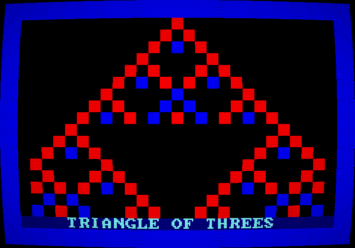

# Milestone 11 — Lore and presentation

## In one paragraph
A computer is more than its circuits: it comes in a box with a manual, people write about it in magazines, and it glows on a television in the corner of the room. This last milestone gives the TRIADA-85 all of that. There is an **owner's manual** written as if printed in 1985, from "what is in the box" to a type-in program from the magazine *Trit & Tryte*, and every example in it is checked against the real machine. There is an optional **CRT look** that makes the sharp picture glow like an old television. The project's front page now has pictures and an animation, made by the machine itself. And a **retrospective** looks back at the whole journey.

## What was built
- **The owner's manual** in [`docs/manual/`](../manual/README.md) ([D-036](../DECISIONS.md#d-036--the-owners-manual-in-universe-chapters-whose-examples-are-tested---milestone-m11-2026-11-08)): a cover with a letter to the owner and contents, then seven chapters (getting started, counting in threes, the monitor, programming, pictures and sound, the Games triskette, the type-in listing) and a quick-reference appendix.
- **A type-in listing**, "Triangle of Threes" ([`programs/triangle.tasm`](../../programs/triangle.tasm), 143 words). It draws Pascal's triangle reduced to trits, then turns the picture by rotating every trit. The manual prints it as 143 POKE lines in balanced ternary and as source.
- **`ManualTest`:** replays all 7 monitor examples of the manual on a booted machine, checks chapter 5's "try it" lines, checks that POKE lines, printed source and program file are the same words, and types the whole listing in through the monitor and runs it.
- **The CRT look** ([D-037](../DECISIONS.md#d-037--the-crt-look-a-shader-in-the-frontend-only-and-an-off-screen-capture-mode---milestone-m11-2026-11-08)): a shader written in GLSL, the graphics card's own programming language (`crt.vert`, `crt.frag`) used by `CrtEffect`, off by default, `--crt` or F2.
- **A capture mode** for the desktop, `--capture FILE [--frames N]`: the picture, with or without the CRT look, saved from an off-screen buffer without showing a window. The command line now lives in `LaunchOptions`.
- **Pictures for the README**, made and checked by `DocImagesTest` ([D-038](../DECISIONS.md#d-038--the-readmes-pictures-are-made-by-a-test-from-the-real-machine---milestone-m11-2026-11-08)): five screenshots and an animated GIF in `docs/images/`, plus a CRT capture.
- **The finished [README](../../README.md)** and **the [retrospective](../RETROSPECTIVE.md)**.
- **22 new tests:** 10 in `ManualTest` (7 of them generated, one per manual example), 6 in `DocImagesTest`, 6 in `LaunchOptionsTest`. Two test classes from M10 now share their autopilots.



## Why it was built this way

**A manual that can't lie.** Writing "type `TERN 42` and you will see …" is easy; being right about it every time is not. While writing chapter 3 we guessed what `PEEK 0 3` would show, and the test proved the guess wrong (see "Problems"). Every monitor example is therefore a little script that a test types into the real machine. The type-in listing is tested the hard way, by typing all 143 lines in.

**POKE lines, like in 1985.** Magazines printed machine code as long columns of numbers, because most readers had no assembler. Our monitor already has `POKE`, so the listing is printed that way, in balanced ternary to fit the magazine's name. Each line is at most 23 characters, inside the monitor's 24-character line. The source is printed too, for the curious and for owners of the (fictional) Developer triskette.

**The CRT look only changes the presentation.** The machine's picture stays the exact 240 × 168 array of 27 colours that every test checks. The shader only changes how the desktop draws it, and only when asked. The emulator's normal look stays sharp and exact.

**Checking a shader without taking over the screen.** In M10 our keystrokes reached another program the user was using, because the TRIADA window was behind it. A shader can only be checked on a real graphics card, so we added a capture mode. It opens an *invisible* window, draws into an off-screen buffer, saves a PNG and quits. Nothing appears on the screen, and the user can keep working.

**Pictures made by the machine.** The README's screenshots are generated by a test from the real machine and compared pixel by pixel in every build, so they can never show something the machine no longer does.

## How it works — the plain-language version

### The manual
The manual speaks as NPO "Triada" would have in 1985: "Thank you for choosing the TRIADA-85", "CAUTION: keep the triskettes away from magnets". It explains balanced ternary with the mileage counter of a car, the memory as a street of houses with house 0 in the middle, and registers as notepads on the processor's desk. A note at the start, clearly marked as written today, says that the machine never existed and how the emulator stands in for the hardware.

### Triangle of Threes
Pascal's triangle is a school classic: each number is the sum of the two numbers above it. Keep only the remainder after dividing by 3 and a pattern of triangles inside triangles appears. On the TRIADA the remainder of a division is rounded to be −1, 0 or +1: a trit, ready to be shown as blue, black or red.

```
   row 0:              +                    1
   row 1:            +   +                  1 1
   row 2:          +   -   +                1 2 1      2 -> -1
   row 3:        +   0   0   +              1 3 3 1    3 ->  0
   row 4:      +   +   0   +   +            1 4 6 4 1  4 -> +1, 6 -> 0
```

After the triangle is drawn, every half second every cell's trit is rotated up (− → 0 → + → −), so the three colours chase each other round.

### The CRT look
Old televisions drew the picture as glowing lines on curved glass, through a mask of red, green and blue dots. A **shader** is a small program that runs on the graphics card once for every pixel of the window. Ours does four things for each pixel:

1. **Curvature:** it looks up the picture a little further out than the pixel's real position, more so near the edges, so the picture seems to bulge.
2. **Scanlines:** each of the machine's 168 picture rows becomes several window rows; the middle ones are bright and the edges darker, so thin dark lines appear between the rows.
3. **Phosphor stripes:** window columns are tinted red, green and blue in turn.
4. **Vignette:** the corners are a little darker.

### Pictures made by tests
A test plays each game for a while (the autopilots from M10 do the playing), enlarges the picture three times, and compares it with the stored file. For the animation it records every third frame of three seconds of OBLAKA, which gives 60 pictures, and saves them as a GIF.

## How it works — the programmer's version

1. **The listing:** [`programs/triangle.tasm`](../../programs/triangle.tasm). Cells hold *trit + 2* (tiles 1–3), so a cell's trit is `tile − 2`, and two cells together are `a + b − 4`. `MOD R0, R1` with R1 = 3 then gives a balanced trit directly, because TRIADA's MOD rounds (SPEC §3.5). The loop `rotate` uses `ROT R0` on the trit and keeps only the lowest trit with `MOD 3`, because ROT turns the 11 zero trits above it into +1s.
2. **The manual's test:** [`ManualTest.java`](../../triada-cli/src/test/java/org/triada/cli/ManualTest.java).
   - `everyMonitorExampleIsTrue` is a JUnit `@TestFactory` that finds every ```` ```monitor ```` block in `docs/manual/*.md`. For each one, it boots a machine, types `CLS`, types each `> ` line, and compares the screen rows with the block.
   - `theListingIsTheProgramInBothForms` compares the page's POKE values, the page's assembled source and the assembled program file.
   - `typingTheListingInAndRunningItDrawsTheTriangle` types every POKE line as printed, 27 keys per frame. Then it runs the program, compares rows 0–16 with Pascal's triangle computed in Java, waits for the first turn, and presses a key to get back to `READY.`.
3. **The CRT look:**
   - [`CrtEffect.java`](../../triada-desktop/src/main/java/org/triada/desktop/CrtEffect.java) compiles the shader pair from [`crt.vert`](../../triada-desktop/src/main/resources/shaders/crt.vert) and [`crt.frag`](../../triada-desktop/src/main/resources/shaders/crt.frag), with `ShaderProgram.pedantic = false` because the driver may optimise unused uniforms away.
   - `CrtEffect.setUniforms()` passes the picture size (240 × 168), `CURVATURE` and `SCANLINES`.
   - In [`TriadaApp.java`](../../triada-desktop/src/main/java/org/triada/desktop/TriadaApp.java), `TriadaApp.drawPicture()` sets the shader on the SpriteBatch (or `null` for the default) before `begin()`, and sets the uniforms after it. Uniforms can only be set while the shader is bound.
   - The heart of `crt.frag`:

```glsl
vec2 p = v_texCoords * 2.0 - 1.0;                 // -1 ... +1 across the picture
p *= 1.0 + u_curvature * (p.yx * p.yx);           // bend outwards, more at the edges
vec2 uv = p * 0.5 + 0.5;                          // back to texture coordinates
float row = fract(uv.y * u_sourceSize.y);         // 0 ... 1 inside one picture row
float scan = 1.0 - u_scanlines * (1.0 - sin(row * 3.14159265));
```
   Line by line: texture coordinates (0 … 1) become −1 … +1, so the middle of the picture is 0. Multiplying by `1 + k·(other coordinate)²` pushes points outwards, more at the edges and corners, which is the bulge. Then they are turned back into texture coordinates. `fract(uv.y · 168)` is the position inside one of the machine's 168 rows, and `sin(π · row)` is 0 at a row's edges and 1 in its middle, so the brightness dips between rows by the amount `u_scanlines`.
4. **The capture mode:**
   - [`LaunchOptions.java`](../../triada-desktop/src/main/java/org/triada/desktop/LaunchOptions.java) parses `--load`, `--crt`, `--capture` and `--frames`.
   - `DesktopLauncher` hides the window (`setInitialVisible(false)`) and disables audio for a capture.
   - `TriadaApp.capture()` runs the frames, draws into a `FrameBuffer` at 3×, and reads it back with `Pixmap.createFromFrameBuffer`.
   - [`Capture.java`](../../triada-desktop/src/main/java/org/triada/desktop/Capture.java) turns OpenGL's bottom-up rows the right way round (`Capture.toImage`) and writes the PNG with javax.imageio.
5. **The pictures:** [`DocImagesTest.java`](../../triada-cli/src/test/java/org/triada/cli/DocImagesTest.java).
   - The autopilots are now static methods, `TrizmeykaTest.autopilot(GameHarness)` and `OblakaTest.autopilot(GameHarness)`.
   - The GIF frames are `TYPE_BYTE_INDEXED` images with a 27-entry `IndexColorModel` built from `Palette.rgb`.
   - `writeGif` writes them with javax.imageio's GIF writer. Each frame's metadata gets a delay of 5/100 s, and the first gets the "NETSCAPE2.0" application extension with repeat count 0, which means loop forever.
6. **Build inputs:** [`triada-cli/build.gradle.kts`](../../triada-cli/build.gradle.kts) declares `docs/manual` and `docs/images` as test inputs, as M10 did for `programs/`, and passes `-Dtriada.updateDocImages` on to the tests.

## Build it yourself from scratch
1. **Write the manual as the machine's makers would,** but decide first what may be fiction (the hardware, the company, the magazine) and what must be true (every number and command). Put the boundary in writing at the front.
2. **Mark examples so a program can find them** (here a fenced block named `monitor`), and write a test that types them into a booted machine and compares the screen. Write the expected screen by hand first, then let the test tell you where you were wrong.
3. **For a type-in listing,** write and test the program as a normal source file. Generate the POKE lines from the assembled words, check the longest line against the monitor's input limit, and test that typing them in reproduces the program.
4. **For a CRT shader,** start from your graphics library's default sprite shader. Change only the fragment shader and keep the default attribute names. Keep it optional and switchable at run time, and make it fail safe when the shader doesn't compile.
5. **To check graphics without a visible window,** render into an off-screen frame buffer of a hidden window and read the pixels back. Remember that OpenGL returns the bottom row first.
6. **Generate documentation pictures from the program itself** and compare them in the normal test run. For an animated GIF with the JDK only: an indexed image per frame, a GraphicControlExtension with the delay, and a NETSCAPE2.0 extension on the first frame for looping.
7. **Tell the build tool** about every file your tests read. Otherwise it may skip them as "up to date".

## How we know it works

```bash
./gradlew :triada-cli:test --tests '*ManualTest' --tests '*DocImagesTest'
```

`BUILD SUCCESSFUL`: 16 tests. The 7 monitor examples, the chapter 5 "try it" lines and the type-in listing all match the real machine, and all five stored PNGs match what the machine draws now.

```bash
./gradlew :triada-desktop:test
```

`BUILD SUCCESSFUL`, including the 6 `LaunchOptionsTest` tests.

To recreate the pictures after changing a game:

```bash
./gradlew :triada-cli:test --tests '*DocImagesTest' -Dtriada.updateDocImages=true
```

**The CRT look was checked by eye** on captures made with:

```bash
./gradlew :triada-desktop:run --args="--load programs/triangle.tasm --crt --frames 140 --capture docs/images/crt-triangle.png"
```

The command prints `[triada] saved docs\images\crt-triangle.png (720 x 504, CRT)`. Looking at the picture shows the slight curve of the glass with a black rim, the darker corners, and, enlarged, the scanlines between picture rows and the red, green and blue stripes. The same command without `--crt` gives the flat, exact picture.

The whole build, `./gradlew clean build`, passes with 540 tests: 250 in triada-core, 98 in triada-assembler, 56 in triada-rom, 98 in triada-cli and 38 in triada-desktop.

## Problems we hit and how we solved them
- **The manual was wrong once, and the test caught it.** For `PEEK 0 3` we wrote that house 2 (the cursor's line) would show 4. The test showed `1: 3` and `2: 3`. Houses 1 and 2 hold the cursor's column and line, and PEEK reads each one while it is printing the lines. When house 1 is read, the cursor stands in column 3, just after `1: `. The manual now explains exactly that, which is more interesting than the original sentence.
- **Our own test helpers, twice.** A too-strict count (8 examples instead of the real 7) and a forgotten system property: Gradle only passes on `-D` settings that the build file forwards, so `-Dtriada.updateDocImages=true` first did nothing.
- **A dull screenshot.** The first TRIZMEYKA picture showed a 3-segment snake and a score of 0. It now lets the autopilot play for 25 seconds first: score 39, and a long snake.
- **No more keystrokes on the user's desktop.** After M10 (where key presses could have reached another application), every window check in M11 was done with the invisible capture mode. The CRT effect therefore has been seen on captured pictures, not by playing with F2 in a visible window. F2 runs the same code path as `--crt`.

## Limitations and what comes next
- The CRT look is a matter of taste, checked by eye. It isn't tuned per screen size, and at 1× (a tiny window) the scanlines can't show.
- The manual covers what the machine does today. It doesn't teach programming in depth: the milestone documents do that.
- The README's GIF is checked for being there, not frame by frame.
- **What comes next** is in the [retrospective](../RETROSPECTIVE.md). The stretch goals of CLAUDE.md are a small high-level language, a cassette-loading effect and a web build. The web build has a head start: M6 already showed that the core compiles with TeaVM.

## New words
- **Capture (mode):** saving the program's picture to a file instead of (or as well as) showing it.
- **CRT (cathode-ray tube):** the glass tube of old televisions and monitors, which drew the picture with an electron beam on glowing phosphor.
- **Fragment shader:** the part of a shader that decides the colour of each pixel.
- **Off-screen frame buffer:** a picture in the graphics card's memory that can be drawn into like the screen, but isn't shown.
- **GIF:** an old image format with a palette of at most 256 colours, which can also hold an animation.
- **Phosphor:** the material on a CRT's glass that glows red, green or blue when the beam hits it.
- **Scanline:** one of the horizontal lines a CRT draws the picture with. Between them are thin darker gaps.
- **Shader:** a small program that runs on the graphics card, for example once for every pixel.
- **Type-in listing:** a program printed in a magazine for readers to type into their computers.
- **Uniform:** a setting that a program passes to a shader, the same for every pixel.
- **Vignette:** a darkening towards the corners of a picture.
